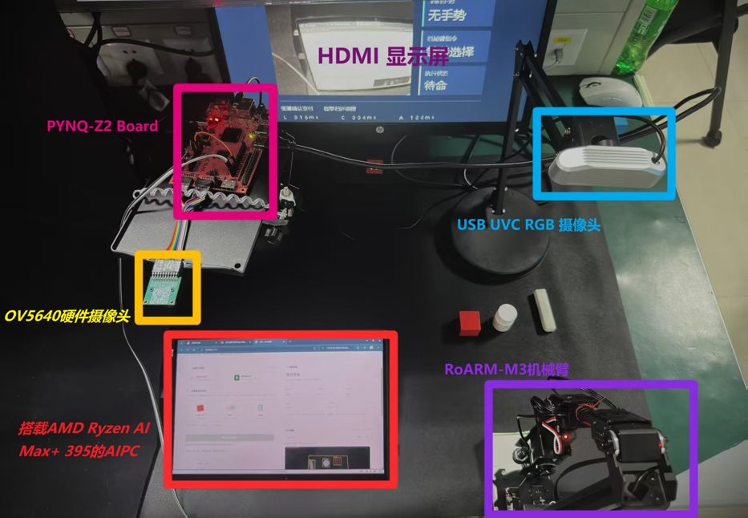

# 硬件、接线与分级运行

板卡 PYNQ-Z2 / XC7Z020CLG400-1；AI PC 已有记录为 ROG Flow Z13 GZ302EA、Ryzen AI Max+ 395、Radeon 8060S、约64GB、Windows 11 25H2。实际运行时记录驱动和依赖版本，不能用这份静态描述替代环境探测。

传感器：PL 侧 OV5640，AI PC 侧普通 USB RGB；执行器 RoARM-M3-S；输出 HDMI。当前版本未使用 RGB-D。RGB 相机的标定和当前布置随配置冻结，更换安装后必须重新标定。

## 装置 BOM

| 部件 | 数量 | 连接或用途 |
|---|---:|---|
| PYNQ-Z2 / XC7Z020 | 1 | DVP 采集、HDMI、TTL 和 JTAG |
| AMD AI PC | 1 | USB RGB 采集、推理、规划和 XSDB |
| OV5640 DVP 模组 | 1 | PYNQ-Z2 JA/JB，手势采集 |
| USB UVC RGB 相机及安装支架 | 各 1 | AI PC USB，俯视桌面。更换安装后重新标定 |
| RoARM-M3-S 含原控制板和夹爪 | 1 套 | TTL 收发和独立原配电源 |
| HDMI 屏及线缆 | 各 1 | 接 PYNQ-Z2 HDMI OUT |
| JTAG USB 线、3.3 V TTL 线束、DVP 短线 | 各 1 套 | 按下列连接表和封存约束 |
| A 槽位及公共点布置、B 物品 | 1 套 | A 用固定红黄蓝槽位，B 用红块、橡皮、小圆罐 |

资料尚未记录两路电源铭牌额定值、支架机械尺寸及孔位、机械臂控制板独立料号。复装时应以实物铭牌与装配测量核实这些项。

## 端到端接线

| 源 | 对端 | 链路 |
|---|---|---|
| AI PC USB | PYNQ-Z2 USB/JTAG | XSDB → AXI MMIO |
| USB UVC 相机 | AI PC USB | RGB 视频 |
| PYNQ-Z2 HDMI OUT | 显示屏 HDMI IN | TMDS 视频 |
| OV5640 | PYNQ-Z2 JA/JB | DVP、SCCB、时钟、3.3 V 和 GND，见下表 |
| PYNQ-Z2 | RoARM-M3-S 控制板 | 3.3 V TTL 交叉收发并共地，见下表 |

现有连接由 [封存现场说明](../project/docs/mode_ab/hardware_setup.md) 提供：

| 信号 | PYNQ 端 | 对端 / 电平 |
|---|---|---|
| TTL TX | PMOD D1 / U12 | RoARM TTL RX，已验证 3.3V 逻辑 |
| TTL RX | PMOD D0 / T14 | RoARM TTL TX，已验证 3.3V 逻辑 |
| 许可 | PMOD D5 / T15 | 既有 3.3V 许可，运行中保持 |
| 地 | GND | 共地 |

机械臂和 PYNQ 使用各自原电源；机械臂供电不能接 GPIO。断电后调整接线。OV5640、HDMI 及其他引脚以 `project/native_motion/constraints/` 和现有装置为准；不根据旧照片推断未记载的接法。

本次整理没有上板。后续现场按“PC 文件/环境→只读查询→空 HOME→A 回归→B 单类→共享红块→连续指标”逐级进行，各阶段准备、观察值、停止条件和回传内容见原现场说明。仅通过当前阶段再进入下一阶段。

首次运行前确认固定空载、已知 HOME、无遮挡、人在旁可停止/断电、D5/实际姿态/布置符合合同。FIST 是普通取消，不能替代现场停止手段。原 p4 启动失败保留历史记录；p4.1 现已实测完成任务。后续任何会话如标记恢复未确认/需要断电复位，仍按原说明处理，不能因版本可用而忽略当前会话状态。新现场条件须重新确认，不沿用本次离线授权。

PC-only 检查不需要额外接线；不得为了收集离线结果启动 hw_server、XSDB、相机或串口。

## OV5640 线束

针脚来自既有实机接线记录，信号封装脚见 [p4.1 XDC](../project/native_motion/constraints/phase2_l2_autonomous_ov5640.xdc)。Pmod 按 PCB 的 pin 1 丝印定位。断电接线，使用 3.3 V 和固定短线束。

| OV5640脚号 | 名称 | PYNQ-Z2接口 | FPGA封装脚 | 说明 |
|---|---|---|---|---|
| 1 | 3V3 | JA6 | - | 只接3.3 V |
| 2 | GND | JA5 | - | 必接；可用Y线再并接JB5 |
| 3 | SCL | JB7 | V16 | SCCB时钟 |
| 4 | SDA | JB8 | W16 | SCCB数据 |
| 5 | VS/VSYNC | JB3 | T11 | 帧同步 |
| 6 | HS/HREF | JB2 | Y14 | 行有效 |
| 7 | PCK/PCLK | JA7 | U18 | 摄像头像素时钟输出 |
| 8 | XCK/XCLK | JB4 | T10 | FPGA到摄像头时钟，勿与PCLK接反 |
| 9 | D7 | JB1 | W14 | 像素数据 |
| 10 | D6 | JA10 | W19 | 像素数据 |
| 11 | D5 | JA9 | W18 | 像素数据 |
| 12 | D4 | JA8 | U19 | 像素数据 |
| 13 | D3 | JA4 | Y17 | 像素数据 |
| 14 | D2 | JA3 | Y16 | 像素数据 |
| 15 | D1 | JA2 | Y19 | 像素数据 |
| 16 | D0 | JA1 | Y18 | 像素数据 |
| 17 | RST | JB9 | V12 | 低有效复位 |
| 18 | PWDN | JB10 | W13 | 高有效休眠 |
