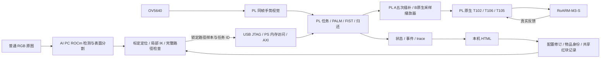

# AB v0.1.0 接口

## 数据流

PC 只在空闲切换或静止 WAIT_PATH 上传配置和路径。S4 独占运动时 PC 不写逐周期关节角。A 数字选物和 A 空槽补回由 PL 自主决定。

## ABI 和新增字段

TASK 基址 `0x43c50000`，PLAN `0x43c40000`，ARM `0x43c30000`，VIS `0x43c60000`。

| TASK 偏移 | 含义 |
|---|---|
| `0x010` | TASK ABI `0x340E` |
| `0x000` | 单 bit W1P 控制：1 enable、2 release、8 cancel、64 abort、256 PATH_COMMIT、512 FIFO_RESET、1024 HEARTBEAT、2048 库存补回确认、4096 共享红槽标空 |
| `0x024` | 模式 bit0；LINE bit1；hold bit2 保持 0；模拟视觉 bit3 保持 0；重新武装/数字选择掩码继承 A |
| `0x058` | 库存命令的请求物品；共享红块命令必须为 1；不代表发起任务 |
| `0x05c` | 路径身份：任务 ID `[31:16]`、实际选择数字 `[1:0]` |
| `0x064` | FIFO 完整段数 `[5:0]`、未完成字序 `[8:6]`、溢出 bit9 |
| `0x068` | FIFO 顺序写入口，每段 8 个 32-bit 字 |
| `0x38c` | B 完整补回 bit0；该 FIFO 的放置开爪段索引 `[13:8]` |
| `0x390` | 只读：PL 实际选中的任务 ID 和数字，不由网页伪造 |

4096 仅在 DYNAMIC_B 版本、OFF/IDLE、无持物/故障、物品 1 时标空 A 红槽；不产生 MOVE。2048 在 B 仅允许恢复共享红槽 1。黄色/蓝色库存行为不变，忙时不能改库存。

FIFO 每段为六个有符号 Q16.16 弧度目标、`flags[31:24]/profile[16]`、`Na[31:16]/N[15:0]`。容量 63 段；回退栈也为 63，拒绝第 64 段且不回绕。共有四个 64 点 bank、64 个共享尾段描述。B OUT FIFO 到中央 PRE，65 个交付位置使用与 A 相同的 PL 有界插值和掌心交互；B 补回使用一个完整 FIFO，不等待 PALM。

WAIT_PATH 可写路径点、段描述、该任务的掌心 bundle 和配套时长；模式、软限位和全局时序策略锁定。COMMIT 扫描开始后 FIFO/路径表关闭写入，ID、数字、抓取标记、补回释放索引和最后 HOME 必须匹配。过期/取消的选择不能提交旧路径。

B heartbeat 为 1500 ms，等待路径上限 65000 ms。PC 在上传批次之间继续 heartbeat。通信错误、许可丢失、反馈超时和固件故障保留既有 PL 处理；释放已提交时按原退出策略完成。PC 收不到明确应答时标记 unknown，锁住后续切换并结束会话检查，不重发运动。

## HTML API

p3 配置锁定与 RGB/物品判定独立。`/api/status` 新增 `control.lock_block_reasons`、`last_request_error`、`mode_progress`、`planning`（当前阶段/类别/后台或任务/elapsed_s）、`boundaries`、`vision_diagnostics`；任务几何错误仍在独立 `planning_error`。POST 的拒绝和异常均记录到 control 日志，包含路径、原因和结果确定性。

p4 保留原有 A 表写入口，新增 B `0x43c20000` 配置窗口（路径 ABI B001，16 阶段，三档，六路无损 Q16 偏移 RAM）；实际 AXI 映射在同包 HWH。B 写入逐字回读后 COMMIT，运行/暂停写锁。详细寄存器与数据结构见 `pc/mode_ab/native_upload.py` 与 `native_routes_p4.md`。A 表的 RAM 镜像只在单一 owner 已成功写完后更新。键点变更写入仍以字 0 清就绪、字 511 置就绪，未变字由同会话已确认镜像保留。新会话从完整 A 启动表建立镜像，任何部分传输异常作废镜像并停止。FIFO 每个真实任务始终完整更新，任务 ID/手势、FIFO 计数读回及 COMMIT 保护不变；不以轨迹缓存代替任务身份。

p2 显示读取现有 TASK STATUS bit19 的实际模式，经过既有帧边界 CDC 更新标题，不新增寄存器或跨时钟接口。B 的抓取与补回使用通用物品/原位文字，类别名称和自定义手势顺序由 HTML 显示；A 文字保持原样。

只监听 `127.0.0.1`。GET `/api/status` 返回真实寄存器快照、配置修订、当前任务和物品原位；未连接/过期不能锁定。POST `/api/mode-lock` 使用 `zhixing.console.bridge.v1`、UUID request_id、expected_revision、A/B 及按序 gesture_bindings。相同 UUID 只应用一次，长 HOME 切换超时后通过状态查询结果。

POST `/api/camera` 选择精确 DirectShow 路径；预览是同一原始帧的真实检测叠加。POST `/api/observation` 只记录人工实物结果。没有网页“开始抓取”接口，没有 PS 模拟手势入口。所有写请求校验会话 token 和同源 Origin。

物品原位按类别身份冻结，包含原始帧、桌面中心/朝向、路径 SHA、配置修订和实际 PL 任务 ID。B 和 A 的共享红块记录在完成及现场可见位置核对时联动；不会把物品重排序当成新物体，也不会把程序完成计数当成已经测得的抓取成功率。
